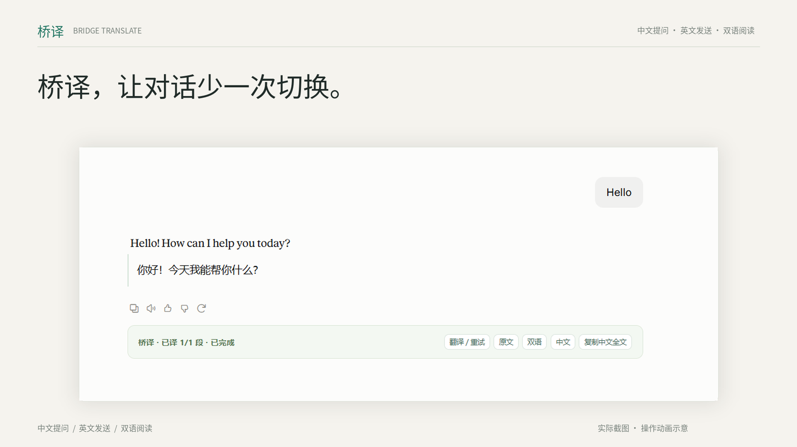

# 桥译功能宣传片

[播放 / 下载 MP4](media/bridge-translate-demo.mp4)



45 秒，1920×1080，30 fps，MP4/H.264，配原创轻背景音，无配音。主画面使用用户提供的三张实际截图。

| 时间 | 展示内容 |
| --- | --- |
| 00:00–00:04 | 中文提问、英文发送、双语阅读 |
| 00:04–00:11 | 中文输入框与 Enter 先译后发送（可选，默认关闭） |
| 00:11–00:17 | Hello 英文对话与中文译文 |
| 00:17–00:26 | URL、Key、模型配置示意，四类协议与兼容接口 |
| 00:26–00:40 | 双语长回答、列表与加粗效果 |
| 00:40–00:45 | GitHub 源码与教程入口 |

这是**实际截图制作的宣传视频**，并非连续的真实操作录屏。Enter 按键、发送步骤、API 配置属于动画示意；实际截图保留原有文字。视频不调用 Claude 或翻译 API，不展示真实密钥。它展示浏览器界面，不能证明 Windows 独立版兼容性，也不替代真实客户端验收。

完整安装、配置与无痕步骤见 [使用指南](使用指南.md)，独立版见 [Windows 教程](../windows/README.md)。

重新生成需要 Python 3、Pillow、NumPy、ffmpeg 与中文字体：

```bash
python -m pip install Pillow numpy
python tools/make-demo.py
```

设置 `BRIDGE_CJK_FONT` 指向字体文件；Windows PowerShell 可运行 `$env:BRIDGE_CJK_FONT="C:/Windows/Fonts/msyh.ttc"`。原始截图不随源码公开。重新生成时，请自行提供三张截图，以 `compose.png`、`greeting.png`、`bilingual.png` 放入本机的 `docs/media/source/`（已加入忽略列表）。脚本只在本机剪辑，覆盖宣传 MP4 和封面，`--poster-only` 只生成分镜与封面。背景音由脚本生成，不使用第三方歌曲。
